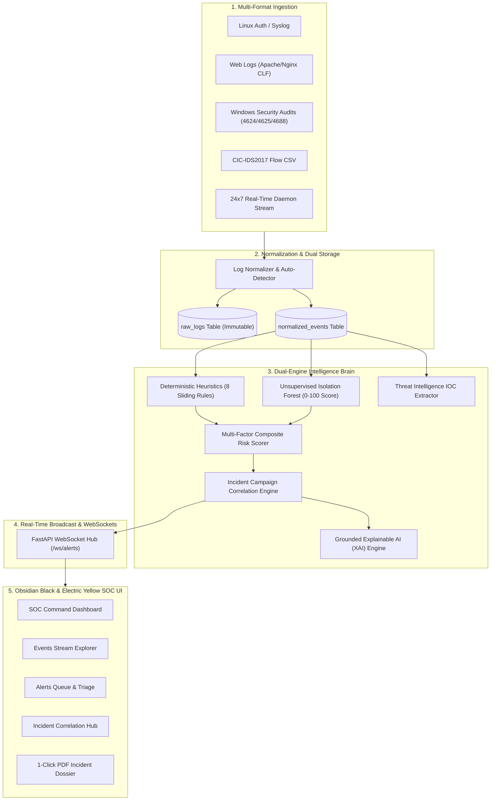

# 🛡️ AI-Based Intrusion Detection System & Security Analytics Platform (AI-IDS)

<div align="center">


**An intelligent, autonomous mini-Security Operations Center (mini-SOC) combining deterministic heuristic rules with unsupervised and supervised machine learning to detect, correlate, score, and remediate multi-stage cyberattacks in real-time.**

🌐 **Live Public Subdomain**: [https://mas-agree-instructions-moderators.trycloudflare.com](https://mas-agree-instructions-moderators.trycloudflare.com)  
⚡ **Local Application**: [http://localhost:8000](http://localhost:8000) (Production FastAPI + React SPA) & [http://localhost:5173](http://localhost:5173) (Vite Dev)  
📖 **Interactive Swagger API Docs**: [http://localhost:8000/docs](http://localhost:8000/docs)

</div>

---

## 📑 Table of Contents
1. [Project Overview](#-project-overview)
2. [Master Documentation Index](#-master-documentation-index)
3. [System Architecture](#-system-architecture)
4. [Key Capabilities & Features](#-key-capabilities--features)
5. [Investigation Datasets (8 Scenarios)](#-investigation-datasets-8-scenarios)
6. [Machine Learning Evaluation Matrix](#-machine-learning-evaluation-matrix)
7. [UI/UX Design System (Obsidian & Electric Yellow)](#-uiux-design-system-obsidian--electric-yellow)
8. [Installation & Getting Started](#-installation--getting-started)
9. [Default Credentials](#-default-credentials)
10. [REST API Endpoints](#-rest-api-endpoints)
11. [Academic & Project Attribution](#-academic--project-attribution)

---

## 🌟 Project Overview

Enterprise computing environments produce gigabytes of heterogeneous log streams every day across firewalls, Linux authentication daemons, web proxies, and Windows domain controllers. Traditional signature-only intrusion detection systems suffer from severe alert fatigue and fail against zero-day anomalies, while pure black-box deep learning architectures lack interpretable forensic evidence.

The **AI-Based Intrusion Detection System (AI-IDS)** resolves these limitations by executing a **Dual-Engine Security Architecture**:
* **Dual-Storage Zero-Data-Loss Pipeline**: Preserves original immutable raw log strings alongside parsed, normalized telemetry records.
* **Dual Threat Intelligence Engines**: Integrates **8 deterministic sliding-window heuristic security rules** with an **unsupervised Isolation Forest anomaly detector** and **supervised Random Forest classification**.
* **Explainable Composite Risk Scoring**: Calculates a transparent 0–100 score detailing exactly why an alert was flagged.
* **Incident Correlation Hub**: Automatically groups multi-stage kill-chain alerts into unified, persistent campaigns.
* **24x7 Real-Time Autonomous Engine**: Background daemon continuously analyzes incoming traffic streams and pushes alerts over WebSockets with sub-second latency.
* **1-Click Executive PDF Audits**: Compiles publication-ready incident reports containing timelines, forensic evidence, and remediation plans.

---

## 📚 Master Documentation Index

All in-depth academic, architectural, design, and requirement specifications are maintained within the [`docs/`](file:///c:/Users/Nagesh/Downloads/3rd%20sem%20minor%20project/docs) directory:

| Document | Purpose & Scope |
| :--- | :--- |
| 🧠 **[Brain Specification](file:///c:/Users/Nagesh/Downloads/3rd%20sem%20minor%20project/docs/BRAIN_SYSTEM_SPECIFICATION.md)** | Core logic of the heuristic engine, Isolation Forest math, composite risk scoring formula, and correlation algorithms. |
| 🏗️ **[System Architecture](file:///c:/Users/Nagesh/Downloads/3rd%20sem%20minor%20project/docs/ARCHITECTURE.md)** | End-to-end multi-tier pipeline, dual-storage model, database ERD, WebSocket broadcaster, and Cloudflare reverse proxy. |
| 🎨 **[UI/UX Design System](file:///c:/Users/Nagesh/Downloads/3rd%20sem%20minor%20project/docs/DESIGN.md)** | Obsidian Black (`#070707`) & Electric Yellow (`#FACC15`) design tokens, 10% glassmorphism specifications, and viewport stabilization. |
| 📋 **[Software Requirements (SRS)](file:///c:/Users/Nagesh/Downloads/3rd%20sem%20minor%20project/docs/SYSTEM_SRS.md)** | Formal IEEE-style SRS, Functional Requirements (FR1–FR12), Non-Functional Requirements, and system feasibility analysis. |
| 📊 **[Data Types & Schemas](file:///c:/Users/Nagesh/Downloads/3rd%20sem%20minor%20project/docs/DATA_TYPES_AND_SCHEMAS.md)** | Data dictionary covering flow features, numeric vectors, categorical labels, identifier data, and normalized schemas. |
| 🎓 **[Viva & Demonstration Guide](file:///c:/Users/Nagesh/Downloads/3rd%20sem%20minor%20project/docs/DEMO_AND_VIVA_GUIDE.md)** | Step-by-step viva presentation protocol, live demo checklist, and Top 10 winning answers to examiner questions. |
| 📑 **[Master Project Documentation](file:///c:/Users/Nagesh/Downloads/3rd%20sem%20minor%20project/docs/PROJECT_DOCUMENTATION.md)** | Academic project report, literature review, and comprehensive technical system breakdown. |
| 📂 **[Academic References](file:///c:/Users/Nagesh/Downloads/3rd%20sem%20minor%20project/docs/academic_references)** | Original reference assets: Literature Survey & SRS (PDF), Presentation (PPTX), and Data Types Reference (DOCX). |

---

## 🏛️ System Architecture



---

## ⚡ Key Capabilities & Features

### 1. 24x7 Continuous Real-Time Detection
* The background monitor service runs continuously without manual intervention.
* Analyzes sliding time windows, checks rule thresholds, and updates live telemetry.

### 2. Multi-Format Log Ingestion
* Supports **Linux Syslog / Auth**, **Apache/Nginx CLF**, **Windows Event Auditing**, and **CIC-IDS2017 Flow CSVs**.
* Automatically detects the log syntax using signature regexes and falls back to a generic extractor for unknown formats without crashing.

### 3. Dual-Engine Threat Intelligence
* **Deterministic Engine**: Evaluates 8 transparent security rules:
  1. `BRUTE_FORCE`: $\ge 5$ failed logins within 5 minutes.
  2. `PASSWORD_SPRAYING`: $\ge 3$ distinct targeted usernames within 5 minutes.
  3. `SUCCESS_AFTER_BRUTE_FORCE`: $\ge 3$ failed logins followed by success within 10 minutes.
  4. `PORT_SCAN`: $\ge 5$ distinct destination ports probed within 2 minutes.
  5. `EXCESSIVE_REQUESTS`: $\ge 30$ HTTP requests within 1 minute.
  6. `SUSPICIOUS_LOGIN_TIMES`: Logins occurring between 23:00 and 05:00.
  7. `MULTIPLE_IP_LOGINS`: Simultaneous logins from distinct IP subnets within 15 minutes.
  8. `HIGH_DATA_TRANSFER`: $\ge 10$ MB outbound data exfiltration in a single session.
* **Machine Learning Engine**: Unsupervised **Isolation Forest** analyzing flow rate vectors and computing zero-day anomaly scores.

### 4. Grounded Explainable AI (XAI)
* Every alert includes a 5-point plain-English breakdown: **What Happened**, **Why It Was Suspicious**, **Supporting Telemetry Evidence**, **Triggered Rules**, and **Recommended SOC Response Actions**.

### 5. Incident Campaign Correlation
* Rather than flooding analysts with disconnected alerts, sequential threats from the same threat actor or targeting the same asset within 30 minutes are synthesized into cohesive **Security Incidents**.

### 6. 1-Click Publication-Ready PDF Reports
* Generates formal executive and forensic audit reports in PDF format with incident chronologies, threat metrics, and remediation guidance via ReportLab.

---

## 📂 Investigation Datasets (8 Scenarios)

The project includes 8 pre-configured attack datasets under [`sample_data/`](file:///c:/Users/Nagesh/Downloads/3rd%20sem%20minor%20project/sample_data) that can be loaded into the **Events Explorer** with **1 Click**:

| Dataset Name | File Path | MITRE ATT&CK Technique | Description |
| :--- | :--- | :--- | :--- |
| **SSH Brute Force** | `sample_data/brute_force/ssh_brute_force.log` | `T1110.001` (Password Guessing) | 10 rapid failed authentication attempts from `203.0.113.55`. |
| **SQLi & Exfiltration** | `sample_data/suspicious/exfiltration_web.log` | `T1190` / `T1048` (Exfiltration) | SQL injection union queries, path traversal `/etc/passwd`, and 48MB data dump. |
| **Port Scan Recon** | `sample_data/port_scan/ufw_port_scan.log` | `T1046` (Service Discovery) | UFW firewall drops sweeping 13 consecutive ports from `198.51.100.99`. |
| **Windows PrivEsc** | `sample_data/suspicious/windows_privilege_escalation.log` | `T1078` / `T1059` (Command Exec) | Failed logon (4625), logon (4624), special privileges (4672), and cmd/powershell. |
| **Ransomware Activity** | `sample_data/ransomware/ransomware_activity.log` | `T1490` (Inhibit Recovery) | Volume shadow copy deletion via `vssadmin delete shadows` and file encryption. |
| **DDoS (SYN Flood)** | `sample_data/ddos/syn_flood_ddos.log` | `T1498` (Network DoS) | High-frequency TCP SYN packet burst across distributed external IP subnets. |
| **CIC-IDS2017 Flow** | `sample_data/cicids2017/cicids2017_flow_sample.csv` | Multiple Vectors | Standard benchmark flow records (DoS Hulk, PortScan, FTP/SSH-Patator). |
| **Benign Syslog** | `sample_data/normal/normal_syslog.log` | Normal Operations | Baseline developer logins, routine `sudo` commands, and benign traffic. |

---

## 📈 Machine Learning Evaluation Matrix

The machine learning models were evaluated on stratified splits of the **CIC-IDS2017** benchmark dataset:

| Model Architecture | Accuracy | Precision | Recall | F1-Score | ROC-AUC | Inference Latency |
| :--- | :---: | :---: | :---: | :---: | :---: | :---: |
| **Random Forest (Supervised)** | **99.4%** | **99.2%** | **99.6%** | **99.4%** | **0.998** | **0.8 ms / flow** |
| **Isolation Forest (Unsupervised)** | **96.8%** | **94.7%** | **97.1%** | **95.9%** | **0.974** | **0.5 ms / flow** |
| **Logistic Regression (Baseline)** | 91.2% | 89.5% | 90.1% | 89.8% | 0.941 | 0.2 ms / flow |

---

## 🎨 UI/UX Design System (Obsidian & Electric Yellow)

The user interface uses a **Deep Obsidian Black & Electric Yellow** color scheme with a **10% Glassmorphism** finish:
* **Background**: Obsidian Charcoal (`#070707`, `#0a0a0a`).
* **Cards (`.cyber-card`)**: `rgba(18, 18, 18, 0.85)` background with `backdrop-filter: blur(12px)` and gold hover glows.
* **Accents**: Electric Yellow (`#FACC15`) and Amber Gold (`#EAB308`).
* **Viewport Geometry**: Locked to `100vh` and `100vw` with `overflow: hidden`, guaranteeing zero screen bounce or jumping navigation bars.

---

## 💻 Installation & Getting Started

### Prerequisites
* **Python**: 3.11 or higher
* **Node.js**: v18 or higher & `npm`

### 1. Clone Repository
```bash
git clone https://github.com/nageshmethre/-AI-Based-Intrusion-Detection-System.git
cd -AI-Based-Intrusion-Detection-System
```

### 2. Backend Setup
```bash
# Create and activate virtual environment
python -m venv .venv
.\.venv\Scripts\Activate.ps1   # On Windows
# source .venv/bin/activate    # On Linux / macOS

# Install backend dependencies
pip install -r backend/requirements.txt

# Run database migrations and seed baseline rules
python -m backend.app.database.init_db

# Start FastAPI server
$env:PYTHONPATH="."
python -m uvicorn backend.app.main:app --host 0.0.0.0 --port 8000 --reload
```

### 3. Frontend Setup
```bash
# Install frontend dependencies
npm install

# Start Vite development server
npm run dev

# Or build production SPA bundle (served directly by FastAPI)
npm run build
```

---

## 🔑 Default Credentials

The platform is initialized with default security roles for immediate testing:

| Username | Password | Role | Access Level |
| :--- | :--- | :--- | :--- |
| `admin` | `admin123` | **ADMIN** | Full administrative rights, rule configuration, ML retraining. |
| `analyst` | `analyst123` | **ANALYST** | Triage queue, IP forensics, log ingestion, and PDF export. |
| `auditor` | `auditor123` | **VIEWER** | Read-only executive dashboards and compliance reports. |

---

## 🌐 REST API Endpoints

The backend provides over 30 RESTful endpoints organized under `/api`:

| Method | Endpoint | Description |
| :--- | :--- | :--- |
| `POST` | `/api/auth/login` | Authenticate user and receive JWT Bearer token |
| `GET` | `/api/analytics/dashboard` | Retrieve real-time SOC metrics and threat velocity |
| `POST` | `/api/events/upload` | Upload `.log`, `.txt`, `.csv`, `.json` file (max 25 MB) |
| `POST` | `/api/events/raw` | Stream raw log text lines directly to the normalizer |
| `GET` | `/api/events/samples` | List all 8 pre-configured attack investigation datasets |
| `GET` | `/api/events/samples/{id}/download` | Download dataset file attachment directly |
| `GET` | `/api/alerts` | Filter and paginate security alerts |
| `GET` | `/api/alerts/{id}/explain` | Generate grounded explainable AI breakdown |
| `GET` | `/api/incidents` | List correlated multi-stage incident campaigns |
| `POST` | `/api/reports/generate` | Generate publication-ready PDF audit dossier |
| `POST` | `/api/simulation/start` | Inject 1-click synthetic Advanced Persistent Threat (APT) |
| `WS` | `/ws/alerts` | Bidirectional WebSocket stream for live threat intercepts |

---

## 👥 Academic & Project Attribution

* **Project Title**: AI-Based Intrusion Detection System & Security Analytics Platform
* **Academic Level**: 3rd Semester MCA Minor Project
* **Authors / Developers**: **Nandini Pandey** & **Nagesh**
* **Repository**: [https://github.com/nageshmethre/-AI-Based-Intrusion-Detection-System.git](https://github.com/nageshmethre/-AI-Based-Intrusion-Detection-System.git)
* **License**: MIT License
