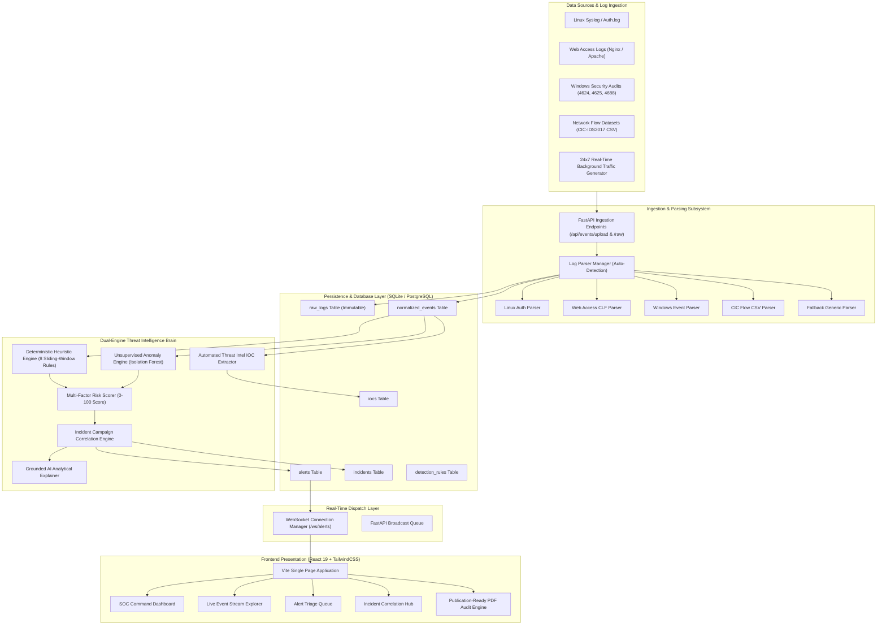
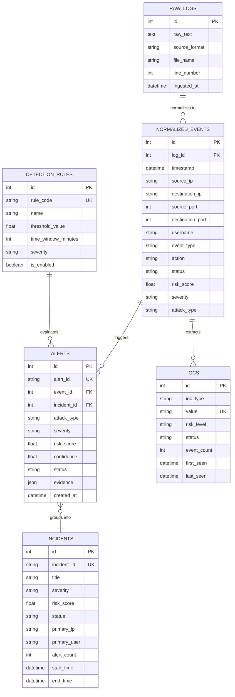

# AI-Based Intrusion Detection System: System Architecture

## 1. Architectural Vision & Core Principles

The **AI-Based Intrusion Detection System (AI-IDS)** is architected as a high-performance, real-time mini Security Operations Center (mini-SOC). It combines modern stream processing, dual-engine threat intelligence, real-time WebSocket communication, and responsive visualization.

### Core Architectural Principles:
1. **Zero Data Destruction (Dual-Storage)**: Immutable original raw logs are always preserved byte-for-byte in relational storage alongside structured normalized events.
2. **Deterministic + Probabilistic Fusion**: Deterministic heuristics provide instant, zero-latency detection of known threats, while unsupervised and supervised ML detect novel anomalies.
3. **Decoupled Asynchronous Processing**: File ingestion and synthetic attack simulations run without blocking dashboard UI interactions.
4. **Resilient Parsing**: The parsing pipeline gracefully falls back to an unknown format extractor rather than discarding malformed lines.
5. **Real-Time Push Model**: WebSocket broadcasting pushes alerts to connected SOC analysts with sub-second latency.

---

## 2. End-to-End System Architecture

---

## 3. Ingestion & Dual-Storage Architecture

When a log batch is received via multipart upload (`POST /api/events/upload`) or streaming paste (`POST /api/events/raw`):
1. **Raw Log Capture**: Each incoming line is assigned a unique identifier, timestamp, source filename, and line index, and committed to `raw_logs`.
2. **Format Auto-Detection**: The `LogParserManager` inspects the leading lines against regex signatures:
   - `sshd\[\d+\]` or `pam_unix` $\rightarrow$ `LinuxAuthParser`
   - Combined Log Format (CLF) $\rightarrow$ `WebAccessParser`
   - `Microsoft-Windows-Security-Auditing` or Event IDs `4624|4625|4688` $\rightarrow$ `WindowsEventParser`
   - Flow headers (`Destination Port, Flow Duration...`) $\rightarrow$ `CICFlowParser`
   - Generic JSON/CSV $\rightarrow$ `CSVJSONParser`
3. **Normalization**: The parsed fields are mapped into the `NormalizedEvent` data contract:
   - `timestamp` (UTC ISO-8601)
   - `source_ip` & `destination_ip` (IPv4 / IPv6)
   - `source_port` & `destination_port` (1–65535)
   - `username` / `identity`
   - `event_type` (`AUTH`, `WEB`, `NETWORK`, `SYSTEM`)
   - `action` (e.g., `SSH_LOGIN`, `HTTP_GET`, `PORT_PROBE`)
   - `status` (`SUCCESS`, `FAILURE`, `BLOCKED`)
   - `severity` (`CRITICAL`, `HIGH`, `MEDIUM`, `LOW`, `INFO`)
   - `bytes_sent` & `bytes_received`

---

## 4. Database Schema & Entity Relationships

---

## 5. Real-Time Communication & WebSocket Architecture

The platform uses bidirectional WebSockets (`/ws/alerts`) to ensure sub-second SOC updates without polling:
1. **Connection Lifecycle**: On initial dashboard load, the React client establishes a persistent connection to `ws://<host>/ws/alerts`.
2. **Broadcaster Dispatch**: When the detection pipeline generates a new `Alert`:
   - It packages the alert into a lightweight JSON payload.
   - Pushes it to all active connections in the in-memory pool.
3. **Client-Side Toast & Sound Cue**: The `DashboardLayout.jsx` intercepts the alert, renders an animated amber/yellow toast in the lower right, and triggers a dynamic state refresh.
4. **Reconnection & Fallback**: If the socket closes, the client uses an exponential backoff algorithm with jitter ($2^n \times 1000\text{ms}$) to restore connectivity.

---

## 6. Deployment & Reverse Proxy Architecture

The production environment is packaged as a unified server model:
* **Backend**: FastAPI running on Python 3.11 with Uvicorn ASGI server on port `8000`.
* **Frontend**: Optimized Single Page Application (SPA) built via Vite and compiled into `dist/`. FastAPI serves these static assets directly with an SPA catch-all route.
* **Public Subdomain**: Routed through Cloudflare Tunnel daemon (`cloudflared`) to `https://mas-agree-instructions-moderators.trycloudflare.com`, providing SSL termination, DDoS protection, and public access without requiring open firewall ports.
